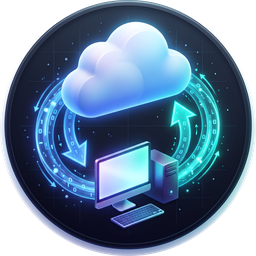

# OurSync

**Google Drive on Linux Mint: streamed, synchronised both ways, with the files you choose kept on
local disk.** What Drive for desktop does on Windows and macOS, on the platform Google never
shipped it for.

Drive appears at `~/Drive` as an ordinary directory tree. Nothing is downloaded until something
reads it, so a corpus far larger than the disk costs nothing to mount: 5 TB of Drive on a 500 GB
laptop is the case this was built for. What has been read is cached and evicted as the cache fills.
A file that must always be fast is **pinned** — a real copy is placed on local disk, served from
there, and never evicted.

```sh
oursync pin   ~/Drive/Audio/session.wav    # keep it on disk
oursync unpin ~/Drive/Audio/session.wav    # give the space back
oursync list                               # what is pinned, and what it costs
oursync refresh                            # pull remote changes into pinned copies
oursync doctor                             # the configuration, its state, and anything wrong
```

Or right-click a file in Nemo: **Make available offline** / **Remove local copy**.

It syncs both ways. Save a file under `~/Drive` and it uploads; delete one and it goes to Drive's
trash; rename one and it is renamed in Drive. Change something in Drive from the web, a phone or
another machine and a streamed file picks it up within the minute, while a pinned file is brought
up to date by `oursync refresh`, which the timer runs every five minutes.

## What it is made of, which is the point

OurSync is a few hundred lines of shell over [rclone](https://rclone.org). Streaming Drive through
a FUSE mount with a bounded local cache is what `rclone mount --vfs-cache-mode full` has done for
years, and it does it at whatever speed the link carries. What rclone genuinely lacks is a way to
say *keep this one*: its cache is eviction-based, and `--vfs-cache-max-age` will throw out the file
you care about to make room for one you opened once.

OurSync closes that gap and nothing else:

```
~/Drive                        an rclone mount of a union remote
  └─ union                     two upstreams, consulted in configured order
       ├─ <pin dir>:nc         local disk - a pinned file is served from here
       └─ gdrive-own:          Drive itself
```

`search_policy=epall` makes a read take the **first** upstream, in configured order, that holds
the path — so a pin wins deterministically rather than by winning a race. `action_policy=epall`
makes a write to an existing file apply to every upstream holding it, so a pinned copy cannot
silently diverge from the copy in Drive. The `:nc` modifier means nothing is ever *created* on
local disk by accident; a pin is placed deliberately and nothing else writes there.

A pin is a *cache* of Drive, not a second replica, and that one sentence settles the sync rule. A
write through the mount reaches both upstreams, so the local copy cannot get ahead by ordinary use.
A change made to Drive from somewhere else reaches only Drive — the union serves the local copy and
never asks — so `oursync refresh` compares each pinned file with Drive and re-copies the ones Drive
has changed. If the local copy is *newer* and differs, something bypassed the mount: that is a
conflict, and a conflict is reported with both timestamps and never resolved by overwriting,
because the thing that would be overwritten might be the only copy of something.

That is the whole design. An earlier version of this repository specified a 15-component FUSE
daemon with its own database and parallel fetch pool, on the premise that one HTTP stream could not
fill a fast downlink. Measurement killed it — see [below](#how-it-got-here).

## Before you install: the Google setup, which cannot be avoided

**OurSync ships no OAuth client ID, and never will.** You create one, once, in your own Google
Cloud project, and it is not optional:

- Seeing your whole Drive needs Google's **restricted** `drive` scope.
- An application that ships its own client ID with a restricted scope needs OAuth verification
  **plus an annually renewed third-party security assessment** — a five-figure yearly cost that no
  free tool is going to carry.
- An OAuth client from *your own* Cloud project falls under Google's documented personal-use
  exemption: no verification, no assessment, and an API quota nobody else is sharing.

So the wall is real, and the trade is a good one: your credential, your project, your quota.
`oursync setup` makes it as short as it can be. It is one run: six pages of Google's console, each
opened for you (or its link printed, over ssh or with no display), with a line or two on what to
click, and Enter to move on.

1. Create a project.
2. Set up the consent screen: "Get started", audience **External**.
3. Fill in the **Branding** page with exactly these values, which are the ones Google's **Publish
   app** button needs before it will work: app name `OurSync`; application home page
   `https://recklesstechnology.com/oursync/`; application privacy policy link
   `https://recklesstechnology.com/legal/privacy/`; and `recklesstechnology.com` under
   "Authorized domains" (the page says "Missing domain" until it is added). Add no logo and no terms
   of service link: an app with a logo has to be verified. Save.
4. Click **Publish app** and Confirm in "Push to production?". This is what keeps the token alive: a
   project left in Google's "Testing" status expires its refresh token after seven days. You do not
   submit for verification. Google's dialog says an app that "requests sensitive or restricted
   scopes" needs it, and the consequence of skipping it is an "unverified app" screen at the consent
   and a cap of 100 users, neither of which matters for your own use. The Branding page afterwards
   offers "Verify branding": ignore it. Publishing means you do not have to add yourself as a test
   user.
5. Create a **Desktop app** client and click Download JSON **before closing the box**: Google never
   shows the secret again. If your browser asks where to save, choose your Downloads folder.
   `oursync setup` finds the file there itself, checks it is a Desktop client (a Web one fails later
   with `redirect_uri_mismatch`, so it is refused now), keeps a private copy and offers to delete the
   download.
6. Enable the Drive API, from a link already pointing at your project.

Setup then opens Google's consent in your browser, and asks Drive one question to make sure the
remote works before it says it is done. You will click through an "unverified app" warning there:
the app is yours and you have not paid Google to verify it. Choose Advanced, then "Go to ...".
If something goes wrong, setup says which of the usual causes it is (the API not enabled, the app
not published or the branding not saved, the wrong kind of client) and gives the link that fixes it. With
`--client-secret PATH`, or a file already at `~/.config/oursync/client_secret.json`, the guided
steps are skipped.

## Install

A `.deb` for each release is on the
[releases page](https://github.com/reckless-technology/oursync/releases).

```sh
sudo apt install ./oursync_*_all.deb
oursync setup                                        # once per user
systemctl --user enable --now oursync-mount.service  # mount it now and at every login
systemctl --user enable --now oursync-refresh.timer  # keep pinned files up to date
oursync doctor                                       # check it over
```

`oursync setup` creates the per-user parts a package cannot: the Drive remote with the client you
made above, the union over it, the configuration file and the pin directory. A `.deb` installs once for a machine, while a Drive
token belongs to a person, so this is the half each user runs for themselves. It is safe to re-run
and will not overwrite a configuration file you already have. `oursync setup --scope drive.readonly`
installs a read-only Drive instead, if that is what you want.

Requirements: Linux Mint 22 / Ubuntu 24.04 or newer, `fuse3`, and **rclone 1.67 or newer, but not
1.68.0**. Mint 22 and Ubuntu 24.04 ship rclone 1.60.1, which is *not* enough, so install the
current one first — this is rclone's own recommended route and takes a few seconds:

```sh
curl https://rclone.org/install.sh | sudo bash
```

That floor is measured, not guessed. `tools/rclone-floor-test.sh` exercises every rclone feature
OurSync depends on — the union's `:nc` and `epall` policies, the VFS cache flags, the write path
through the mount, the control port and the single-file `lsjson` that `refresh` reads — and it was
run against rclone's own release binaries from 1.60.1 to 1.76.0 on 2026-11-18. Below 1.67 a save to
a pinned file reaches Drive but not the local copy, and 1.68.0 alone cannot read the mount's
control-port address from the environment. OurSync checks this itself and refuses to mount rather
than let either failure happen quietly, because both are silent.

From a checkout, without a package: `./rclone/install.sh` installs the same thing under `$HOME`,
needing no root.

## What it does not do

[docs/parity.md](docs/parity.md) is the full feature-by-feature comparison with Drive for desktop,
each row saying how it was established. The ones worth knowing before you install:

- **No differential upload — Google's own client can do this and nothing else can.** Since October
  2024 Drive for desktop uploads only the changed parts of a large file, through something
  undocumented. No public Drive API exposes it: there is no write-at-offset, no append, no patch,
  no block or signature endpoint, and a revision cannot be made from a diff. Editing four bytes of
  a 2 GB file means re-uploading 2 GB. This was verified against the whole v3 method list, and is
  the single largest thing wrong with using Drive this way.
- **Status in Nemo only.** The right-click entries are Nemo's; other file managers, GTK file
  choosers and `ls` show no pin status. The mount itself works everywhere.
- **Google Docs, Sheets and Slides are not editable through the filesystem.** They have no byte
  stream to serve, and appear as small stub files that open in the browser.
- **One account.** A second Google account needs a second remote, union and mount; the scripts
  assume one of each.
- **No "Computers" backup roots.** The API offers no way to discover them.
- **A file saved into `~/Drive` while the mount is down goes to local disk, not to Drive.** This is
  how every FUSE mount on Linux behaves, OurSync's included: the mount point is an ordinary empty
  directory when nothing is mounted on it, so a write lands there and is then hidden underneath the
  mount when it comes back. Nothing is destroyed — the file is still on disk, and visible again if
  the mount is stopped — but it is not in Drive and nothing says so.

  The window is small and it closes by itself. Measured on 2026-11-18: killing the rclone process
  outright, `systemd` restarts it and `~/Drive` is usable again in about 15 seconds, which is the
  unit's `RestartSec` plus startup. `oursync doctor` says plainly whether the mount is up. If a
  program was writing across that moment, stop the mount and look in `~/Drive` before starting it
  again — anything sitting there went to disk rather than to Google.

## How it got here

[docs/measurements.md](docs/measurements.md) is the record, with every figure, the machine and the
date beside it, and the runs that were void and why. The short version: a single range request
against real Drive averages **65.5 MB/s** over Wi-Fi on the test laptop, `rclone mount` keeps up at
**62.3**, and parallel requests show no effect that clears the measurement spread. The daemon's
central premise was false, so the daemon was not built.

[docs/design.md](docs/design.md) is that daemon's specification, kept as research rather than as a
plan. Its survey of the Drive API — the quota arithmetic, the name mapping, the failure modes, the
absence of delta upload — is sound and still answers questions. Its architecture is history.
[docs/plan.md](docs/plan.md) is what is actually next.

## Licence

GNU General Public License, version 3 or later. See [LICENSE](LICENSE) for the licence,
[COPYRIGHT](COPYRIGHT) for the statement and what it does not cover, and [NOTICE](NOTICE) for what
OurSync needs at run time and does not distribute.
